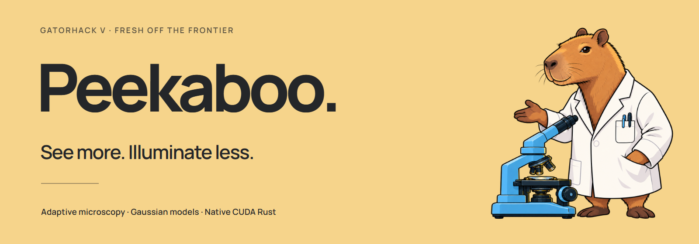
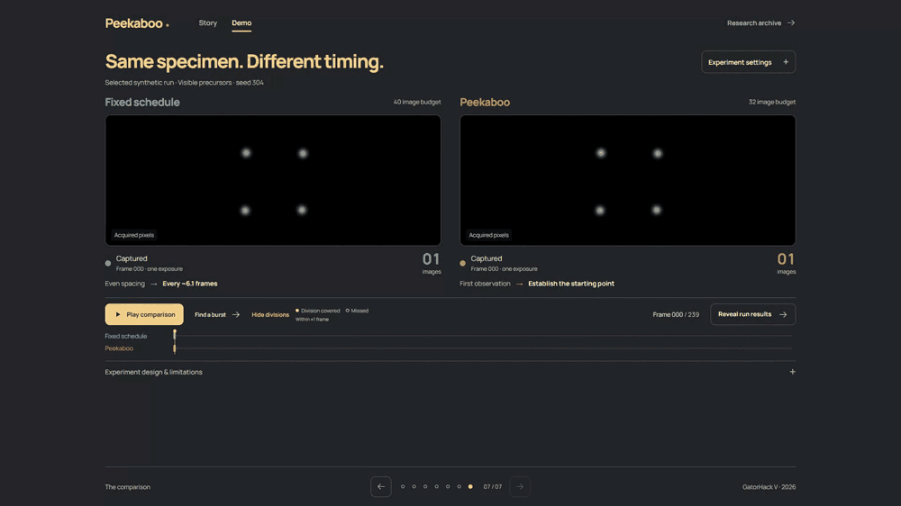
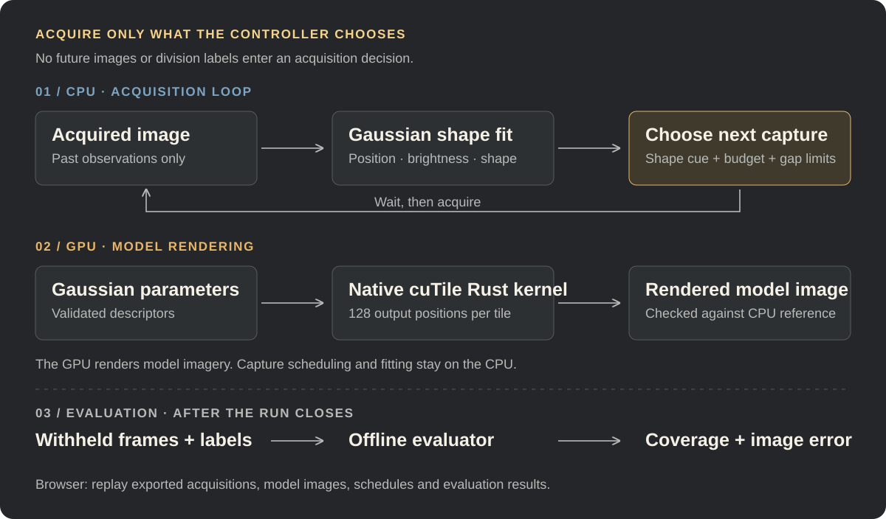
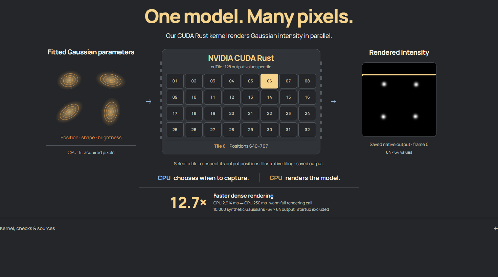

<p align="center">
  <strong>Software that chooses when a microscope should take its next picture.</strong><br />
  Gaussian cell models, causal acquisition scheduling, and native CUDA Rust rendering.
</p>

<p align="center">
  <a href="#see-the-difference">Demo</a> ·
  <a href="#fresh-off-the-frontier">Frontier technology</a> ·
  <a href="#how-it-works">Architecture</a> ·
  <a href="#what-we-measured">Results</a> ·
  <a href="#run-it-locally">Quick start</a>
</p>

## The idea

Microscopes need light to image living cells. Too much illumination can damage
those cells and disrupt the biology researchers are trying to observe—a problem
known as [phototoxicity](https://www.nature.com/articles/s41467-025-66209-6).
Imaging less often reduces acquisitions, but can miss a division between frames.

**Peekaboo asks a different question: when is the next image worth taking?**

It uses the shape of nuclei in acquired images to choose the next observation
time. Stable shapes allow longer gaps; visible elongation triggers closer
observation. A budget and gap constraints keep the schedule feasible.

This is a working research prototype: an offline acquisition controller,
reproducible experiments, a native GPU renderer, and an interactive replay.
The scientific package is named **PHOTON** in the source code.

## See the difference



*Recorded application replay. Blue is fixed timing; amber is Peekaboo. Each panel
holds its own last acquired image between captures. [Open a still](docs/assets/readme/comparison.png)
or [inspect the completed result](docs/assets/readme/results.png).*

In the featured controlled example, both methods observe the same 240-frame
sequence. Peekaboo concentrates captures around visible changes:

| | Peekaboo | Fixed intervals |
|---|---:|---:|
| Images acquired | **32** | 40 |
| Divisions covered | **4 / 4** | 1 / 4 |
| Relative imaging exposure | **80%** | 100% |

**20% fewer exposures**, assuming equal illumination per image. Division coverage
means a capture within **±1 source frame** of the event. Seed 304 was selected
after evaluation to illustrate a successful case; it is not an independent test.
All six seeds, equal-budget comparisons, and unfavorable cases remain accessible.
[Protocol, selection, and evidence →](docs/LOWER_CAPTURE_DEMO.md)

## Fresh off the frontier

Built for **GatorHack V 2026 · Fresh off the Frontier**.

The central frontier technology is **NVIDIA cuTile Rust**. We wrote a native
Gaussian-intensity GPU kernel in Rust; the resulting model images are used in
the demo. This is the computation behind the visualization, rather than a
browser effect standing in for GPU execution.

- **NVIDIA cuTile Rust:** [initial tagged release, April 7, 2026](https://github.com/NVlabs/cutile-rs/blob/main/CHANGELOG.md); [NVIDIA announcement, September 8, 2026](https://developer.nvidia.com/blog/introducing-cuda-rust-two-tracks-for-writing-gpu-kernels/). Used for our native rendering kernel, CPU-reference comparisons, and rendering benchmark.
- **CellSplat4D:** [first arXiv submission, October 3, 2026](https://arxiv.org/abs/2610.04199). Inspiration for representing cellular observations with evolving Gaussian geometry. Our model is simplified and does not reproduce the paper's full method.

The tagged release and the announcement are distinct dates. The specific recent
tooling is our technology anchor; Gaussian mathematics itself is not new.
[Technology scope and source notes →](docs/DEMO_PREP.md#3-how-we-fit-fresh-off-the-frontier)

## How it works



1. **Observe.** A causal replay oracle exposes only images the controller acquires.
2. **Estimate.** CPU fitting represents acquired nuclei with position, brightness,
   and covariance. The featured controller uses visible shape elongation as a cue.
3. **Decide.** It chooses a shorter or longer capture gap while respecting the
   declared image budget and spacing constraints.
4. **Evaluate.** After the run closes, an independent evaluator uses withheld
   frames and event annotations to measure coverage and image error.

The **CPU fits shapes and chooses acquisition times**. The **GPU renders Gaussian
models**. The **browser replays saved outputs** and exposes their provenance.
In the featured demo, a displayed Gaussian fit is held until the next acquisition;
it does not reveal a future division.

<details>
<summary><strong>The Gaussian renderer, in more detail</strong></summary>

Each component has amplitude $a_i$, mean $\mu_i$, and covariance $\Sigma_i$.
The renderer evaluates their summed intensity at output coordinates $x$:

$$
I(x) = \sum_i a_i \exp\!\left[-\frac{1}{2}(x-\mu_i)^T\Sigma_i^{-1}(x-\mu_i)\right].
$$

The Python bridge validates and packs descriptors. A Rust worker evaluates output
positions in cuTile kernels, returns the rendered fields and timing metadata,
and is checked against a CPU reference. A persistent worker amortizes startup.
Explicit CUDA requests report failures; automatic mode can record a CPU fallback.

The broader scientific package also implements causal tracking, Gaussian
forecasting, and heuristic uncertainty. Those are separate from the featured
morphology-driven scheduling result and have their own evaluation records.

[Kernel source](crates/photon-gpu/src/main.rs) ·
[Python bridge](services/science/photon/gpu.py) ·
[Gaussian model](docs/gaussian-model.md) ·
[Controller design](docs/acquisition-controller.md)

</details>

## What we measured

### Acquisition timing

The complete lower-budget cohort includes six evaluation seeds, three conditions,
and both 32-image and 40-image fixed comparators:

| Condition · six seeds | Peekaboo · 32 images | Fixed · 40 images | Fixed · 32 images |
|---|---:|---:|---:|
| Visible division precursors | **23 / 24** | 11 / 24 | 8 / 24 |
| Sudden divisions without a precursor | 4 / 24 | **11 / 24** | 8 / 24 |
| Quiet specimen | No events to score | No events to score | No events to score |

The useful result is conditional: **an observable precursor can make adaptive
timing worthwhile**. A sudden event between sparse captures can still be missed.
The image budget is declared in advance; the controller does not discover a
minimum required image count. [Full cohort and portable evidence →](docs/CONTROLLED_BUDGET_RESULTS.md)

### Native GPU rendering



| Dense rendering workload | CPU reference | Persistent GPU worker |
|---|---:|---:|
| Warm full rendering call, median | 2,914 ms | **230 ms** |

**12.7× faster rendering** for 10,000 Gaussians and a 64 × 64 output. These are
15-sample warm medians, including per-call bridge costs and excluding startup.
Measured on an Intel Core Ultra 9 185H / RTX 4070 Laptop GPU with WSL2, CUDA 13.3,
and cuTile 0.5.0. This is a rendering-call result; it does not establish an overall
application speedup. Smaller workloads can favor the CPU, which remains available.
[Timing definitions, hardware, parity checks, and full latency audit →](docs/cuda-latency-audit.md)

### Real microscopy and current limits

Our separate benchmark on **two held-out MSKCC-CONFOCAL embryos** completed
**36 runs across six sequence/budget conditions**. Fixed timing covered more
annotated divisions in every condition. That experiment used the earlier frozen
controller, rather than the newer controller in the featured demonstration.
[Complete real-data findings →](docs/PHASE5_RESULTS.md)

The controlled result motivates further work; it does not establish the same
benefit on living specimens. Acquisition count is an exposure proxy. **Cell health
and reduced phototoxicity have not been measured**, and microscope hardware is not
connected to this prototype.

## Run it locally

### Interactive demo · no GPU required

Use **Node.js 22.12+ or 24**. From the repository root:

```bash
cd apps/web
npm ci
npm run dev -- --port 5173 --strictPort
```

Open **http://127.0.0.1:5173** and select **Demo**. Portable demo images, schedules,
and results ship with the repository; the primary replay needs no Python process,
API key, dataset download, or CUDA installation.

Try **Play comparison**, **Show divisions**, and **View results**. Experiment
settings expose the other seeds, sudden divisions, quiet specimens, equal-budget
mode, and a 32-image fixed baseline. The Gaussian and CUDA story slides explain
the representation and rendering path interactively.

To build a static version:

```bash
npm run build
npm run preview -- --port 4173 --strictPort
```

The optional real-data research archive requires separately generated local
assets and retains an older partial display snapshot. The complete Phase 5
scientific results are documented in [PHASE5_RESULTS.md](docs/PHASE5_RESULTS.md).

<details>
<summary><strong>Reproduce the controlled experiment in Python</strong></summary>

Use Python 3.11+; the locked environment was verified on Windows with Python 3.13.5.
Run these PowerShell commands from the repository root:

```powershell
python -m venv .venv
.venv/Scripts/python.exe -m pip install -r requirements-dev.lock
.venv/Scripts/python.exe -m pip install --no-deps -e .

$env:OMP_NUM_THREADS = '1'
$env:OPENBLAS_NUM_THREADS = '1'
$env:MKL_NUM_THREADS = '1'
.venv/Scripts/python.exe scripts/probe_controlled_budget.py --output runs/budget-reproduction
```

On Linux, use `.venv/bin/python`. Choose a fresh output directory: scientific
scripts refuse to overwrite existing evidence. The probe compares the declared
budgets across development and evaluation seeds, with a 120-second execution cap.

[Registered protocol](docs/CONTROLLED_BUDGET_PROBE.md) ·
[Saved verification](docs/evidence/controlled-budget32-v1/verification.json) ·
[Detailed implementation/reproduction notes](docs/RESEARCH_GUIDE.md)

</details>

<details>
<summary><strong>GPU execution and scientific verification</strong></summary>

Native CUDA execution needs the pinned Rust/CUDA environment and upstream sources;
it is not required for the frontend replay. The validated setup used WSL2 Ubuntu
22.04, an NVIDIA GPU, and CUDA 13.3. See the
[GPU setup notes](docs/RESEARCH_GUIDE.md#layout-and-gpu-status) and
[latency reproduction guide](docs/cuda-latency-audit.md#reproduction).

Useful verification entry points, after installing the scientific environment:

```powershell
.venv/Scripts/python.exe -m pytest -q
.venv/Scripts/python.exe scripts/run_phase5.py verify
```

Phase 5 verification requires the corresponding local artifacts; raw datasets,
generated runs, binaries, and credentials are intentionally excluded from Git.
Recreating the real-data experiment also requires the licensed dataset download.
The [frozen evaluation protocol](docs/PHASE5_RESULTS.md) and
[living build record](BUILD_PHASES.md) distinguish completed checks from pending work.

</details>

## Project map

| Path | Responsibility |
|---|---|
| [`apps/web/`](apps/web) | React, TypeScript, and Three.js presentation, replay, and evidence views. |
| [`services/science/photon/`](services/science/photon) | NumPy/SciPy/TIFF pipeline: replay oracle, fitting, tracking, scheduling, evaluation, and GPU bridge. |
| [`experiments/controlled/`](experiments/controlled) | Controlled sequence generation, event-focus controller, and closed-run scoring. |
| [`crates/photon-gpu/`](crates/photon-gpu) | Native cuTile Rust Gaussian renderer and persistent worker. |
| [`scripts/`](scripts) | Dataset preparation, bounded experiments, asset export, benchmarks, and independent verification. |
| [`docs/`](docs) | Scientific protocols, dated sources, results, audits, and portable evidence. |
| [`video/`](video) | Isolated Remotion submission-video project with its own dependencies and audio workflow. |

Start with [PHOTON_SPEC.md](PHOTON_SPEC.md) for the scientific contract,
[DEMO_PREP.md](docs/DEMO_PREP.md) for a guided walkthrough, and
[BUILD_PHASES.md](BUILD_PHASES.md) for implementation history.

## Research and credits

- **Biological motivation:** [PhotoFiTT, Nature Communications (2025)](https://www.nature.com/articles/s41467-025-66209-6), on quantitative phototoxicity assessment.
- **Research inspiration:** [CellSplat4D](https://arxiv.org/abs/2610.04199), Yingda Tao and Guoyu Lu. Our simplified Gaussian approach is not a reproduction of the full paper.
- **GPU tooling:** [NVIDIA cuTile Rust](https://github.com/NVIDIA/cuda-rust); the project's pinned local toolchain is described in the GPU audit.
- **Real microscopy:** [MSKCC-CONFOCAL author deposit](https://zenodo.org/records/6460303), Anthony Santella, Ismar Kovacevic, Zhirong Bao, and Peter Hirsch, **CC BY 4.0**. [Dataset and annotation audit](docs/mskcc-audit.md).
- **Interface assets:** Manrope, Three.js, and the adapted SideRays effect retain their [bundled notices](apps/web/public/third-party) and [effect license](apps/web/src/SideRays.LICENSE.md). [README image provenance](docs/assets/readme/README.md).

The next step is to test whether informative morphology cues generalize to real
specimens, calibrate the scheduling policy, and validate an acquisition loop with
microscope hardware and measured light exposure.

<p align="center"><strong>See more. Illuminate less.</strong></p>
