# Peekaboo visual exploration

Fifteen preliminary visual directions plus L implementation refinements. The current exploration is **round five: capybara scientist, solid colors, and optional SideRays**. L was selected and partially implemented, then rejected during frontend QA. **M / After Hours is now selected.** See the [refined design handoff](../AFTER_HOURS_DESIGN.md) and [screen board](after-hours/screen-board.png). Generated with ImageGen. Specimen imagery, schedules and controls on these boards are illustrative placeholders, not experimental evidence.

## Current round — capybara scientist

Brief and next steps: [CAPYBARA_DESIGN_BRIEF.md](../CAPYBARA_DESIGN_BRIEF.md).
Prompts: [round-five-prompts.md](round-five-prompts.md).

### M — After Hours

Charcoal, butter yellow, blue and amber. Editorial cel illustration and an evening-lab atmosphere; strongest setting for restrained SideRays.

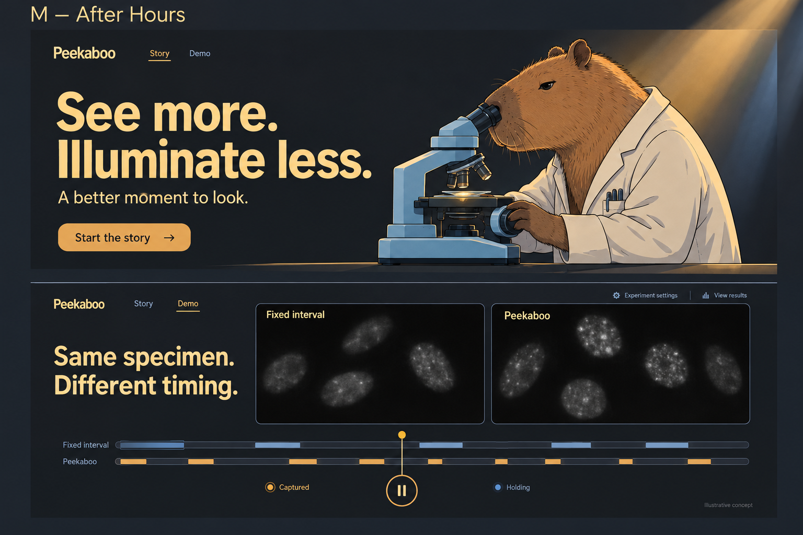

### N — Apricot Lab

Solid apricot, aubergine and copper. Warm illustrated lab, serif headline, expressive capybara scientist.

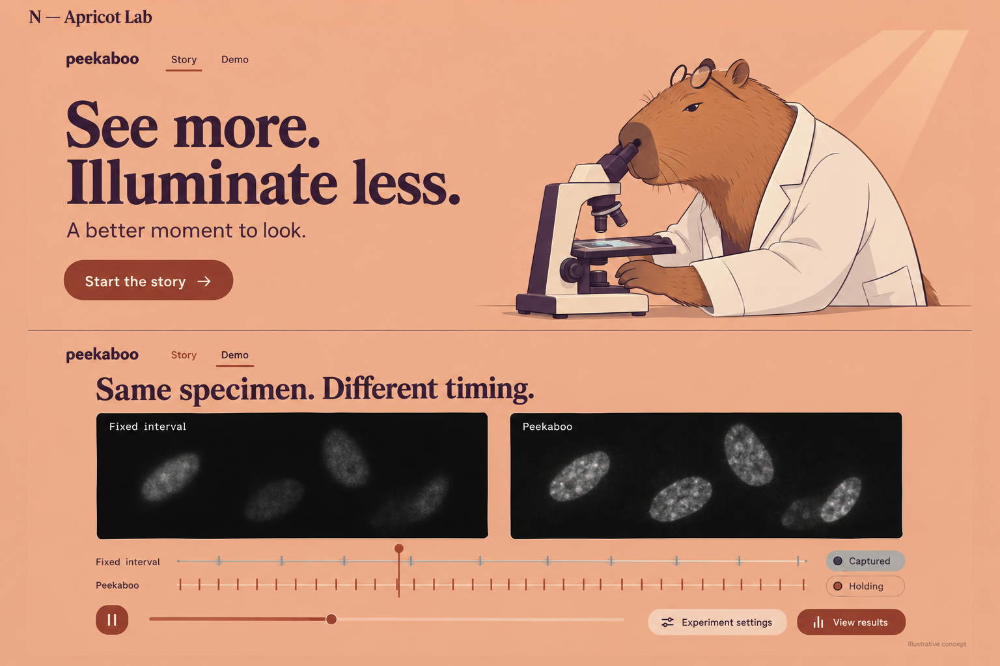

### O — Field Station

Moss green, pale yellow-green, terracotta and mint. A calmer natural-history identity with bold clear typography.

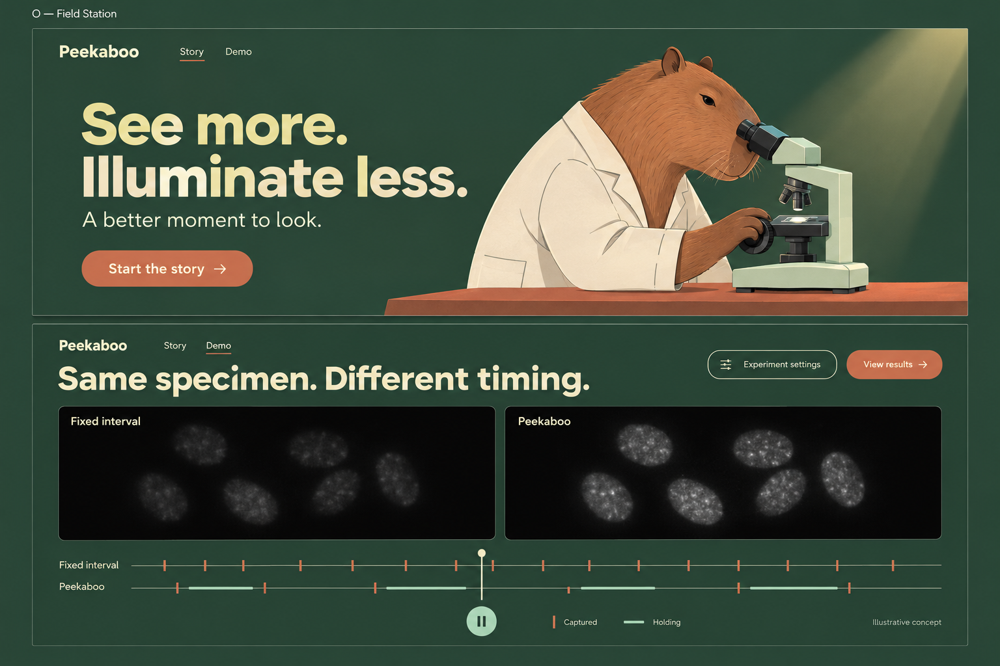

These are identity boards, not production assets. Refine the chosen character's
eye-to-eyepiece alignment, simplify fur/shading for animation, and keep final
surfaces truly solid outside the restrained ray effect. Demo capture schedules
and image windows must use actual saved data; do not copy the generated timing
patterns or the boards' implied image differences.

## Earlier rounds

## A — Aperture

Persimmon orange and aubergine, bold condensed typography, and shutter-like reveals.

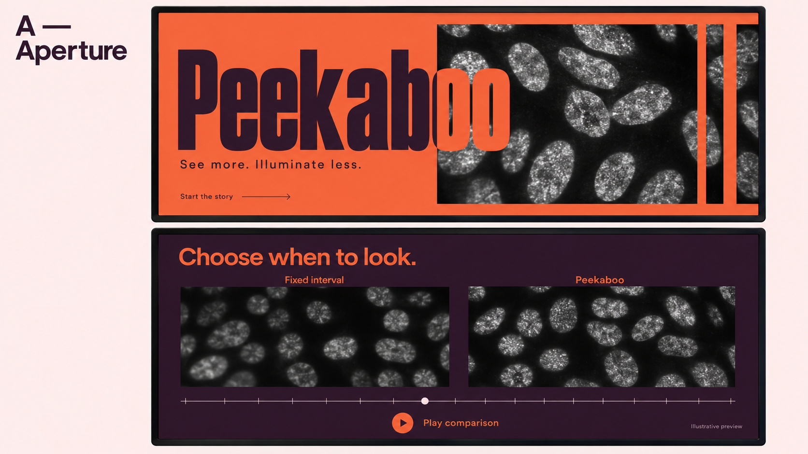

## B — Field Notes

Citron and dark navy, expressive serif typography, and editorial specimen plates.

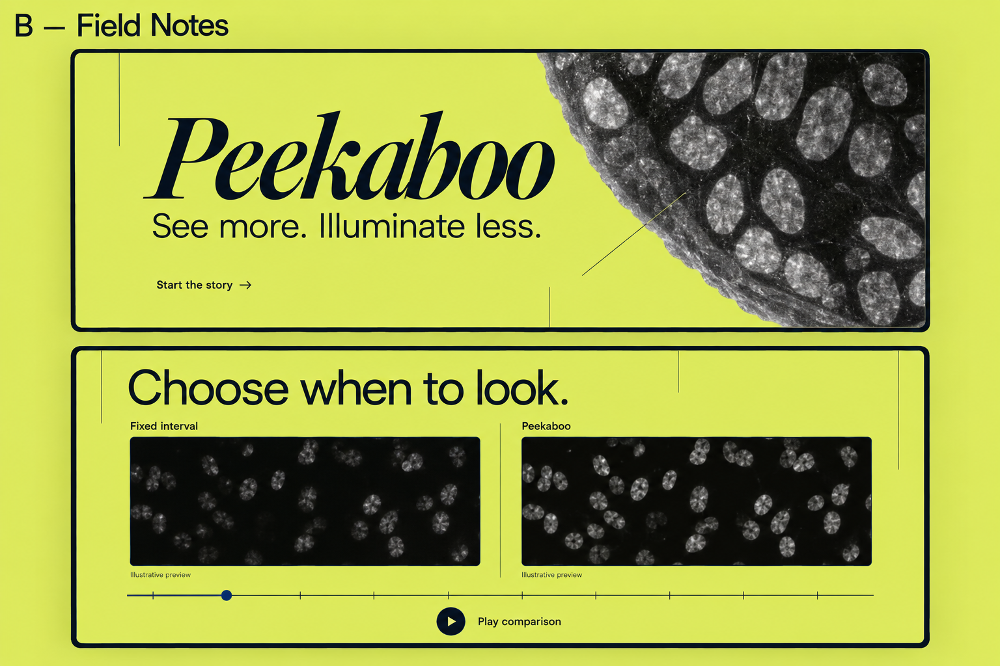

## C — Afterimage

Cobalt and pale lime, geometric typography, film strips, and capture marks.

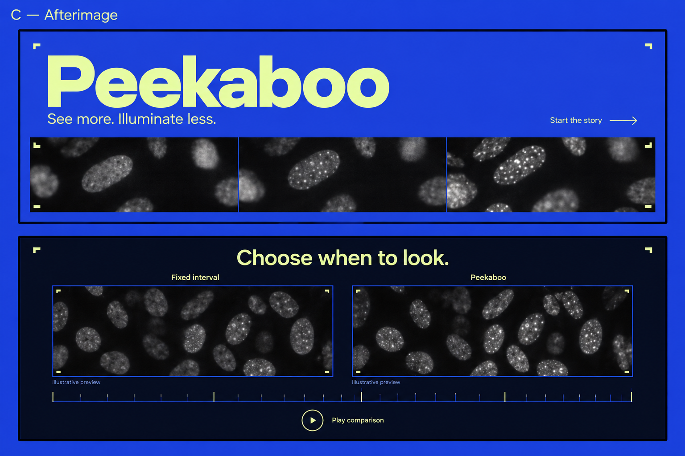

## Round two

These boards explore identity and composition, not final scientific diagrams or playback controls. Actual dataset images and verified demo assets would replace illustrative imagery. Generation prompts: [round-two-prompts.md](round-two-prompts.md).

## D — Contact Sheet

Vermilion and peach, large serif typography, and photographic sleeves/contact prints. The most editorial direction.

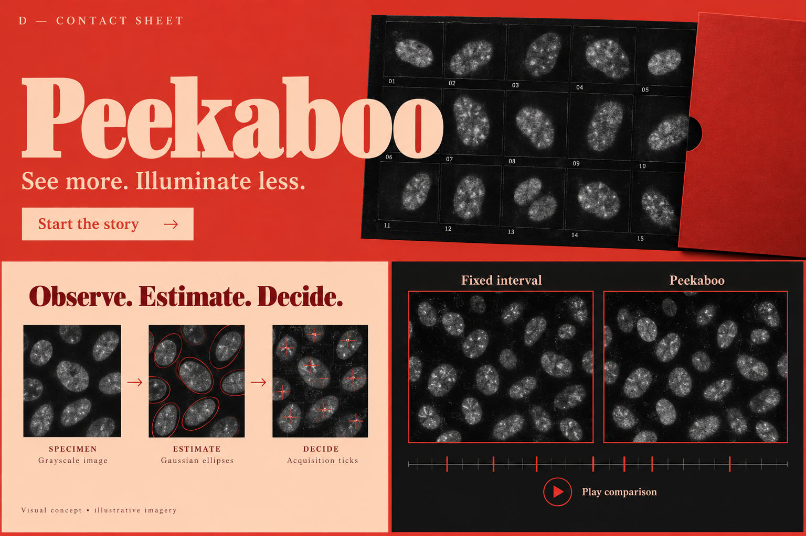

## E — Blind Spot

Lilac, forest green, and chartreuse, with geometric masks that reveal the specimen. The most graphic and playful direction.

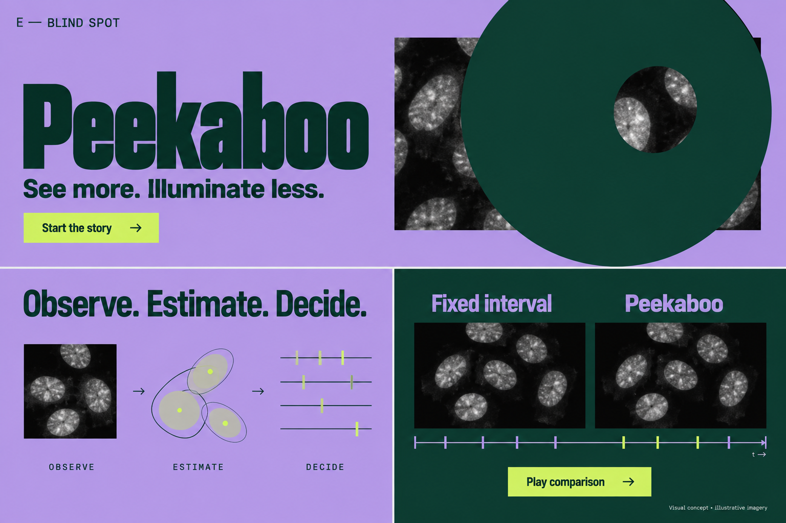

## F — Living Instrument

Petrol teal and apricot, industrial typography, and a conceptual glass-slide overlay. The most tactile direction.

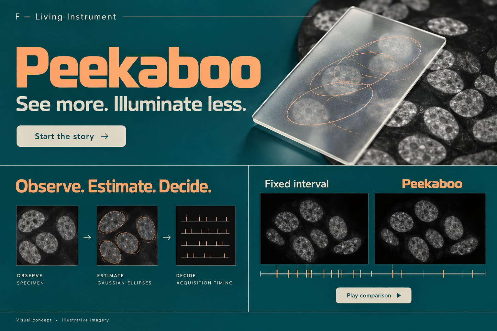

## Round three — charcoal and custom components

The user requested themed custom components that feel strong but restrained. These boards explore playback controls, exposure timelines, slide navigation, and captured/holding states. Controls, timing labels, images, and diagrams are provisional, not actual playback evidence. The component-study panel is a design reference, not a proposed panel in the app. Generation prompts: [round-three-prompts.md](round-three-prompts.md).

## G — Aperture / Charcoal

Warm charcoal, bold persimmon typography, and squared controls with orange active states.

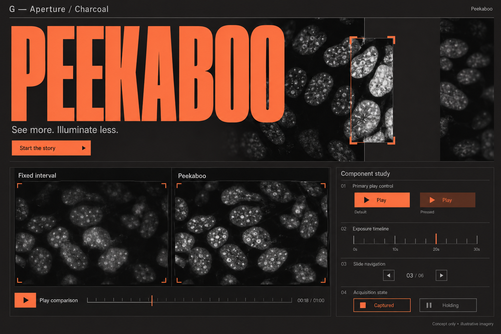

## H — Aperture / Silver

Cool graphite, pale silver typography, fine rules, and minimal orange interaction accents.

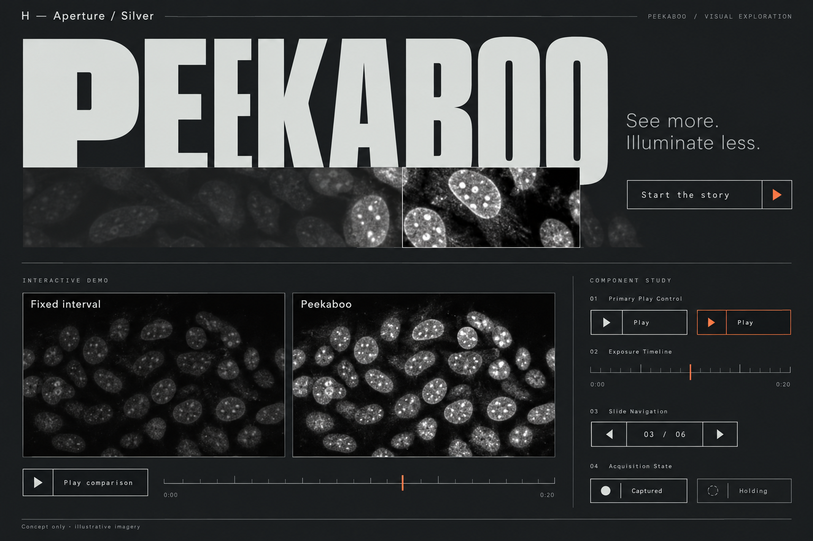

## I — Aperture / Ember

Charcoal and burnt-orange color blocking, pale peach typography, and stepped rectangular details.

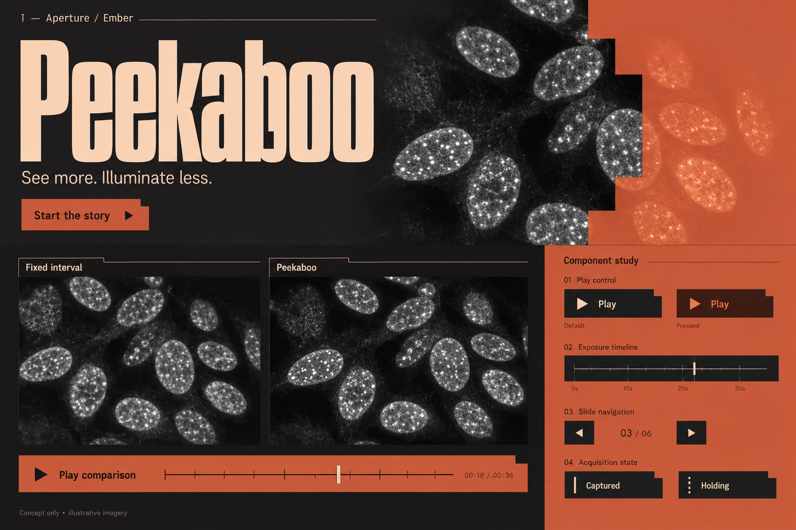

## Round four — calm and intentional

Inspired by the spacious hierarchy, serif headline, atmospheric backdrop, and restrained navigation in the user's supplied Cluely screenshot. These borrow visual qualities, not that site's content or product. The screenshot remains outside the repository because it includes unrelated browser context. The original slide-story-to-demo flow still applies; stacked screens here are a comparison board, not a prescribed scrolling page. Prompts: [round-four-prompts.md](round-four-prompts.md).

## J — First Light

Airy blue, sea-glass light, navy serif typography, and an illustrative specimen landscape.

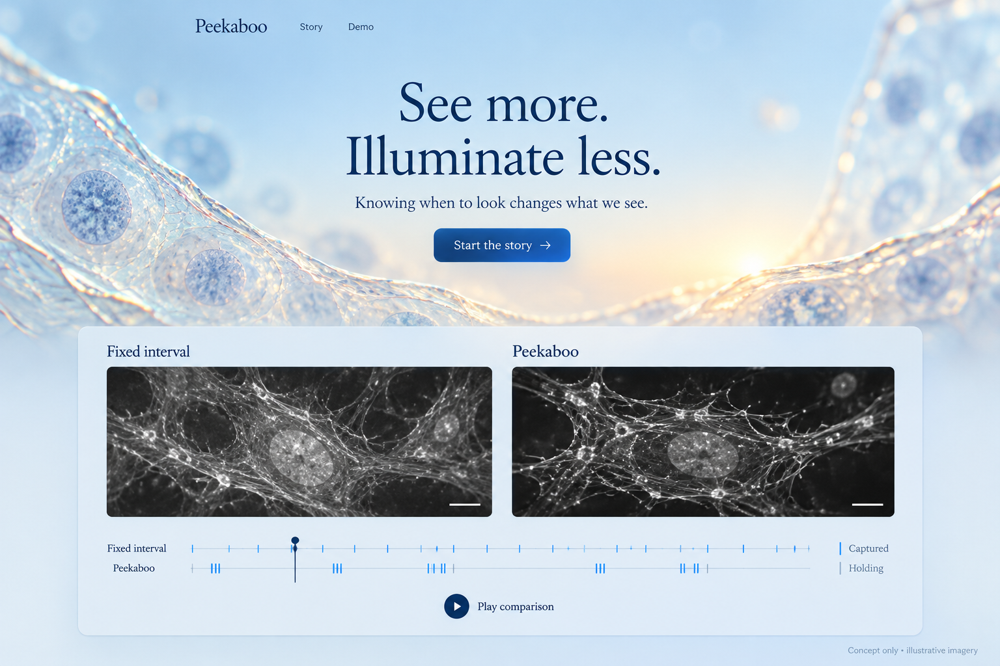

## K — Quiet Observatory

Charcoal, ivory serif typography, restrained amber accents, and a softly lit specimen backdrop.

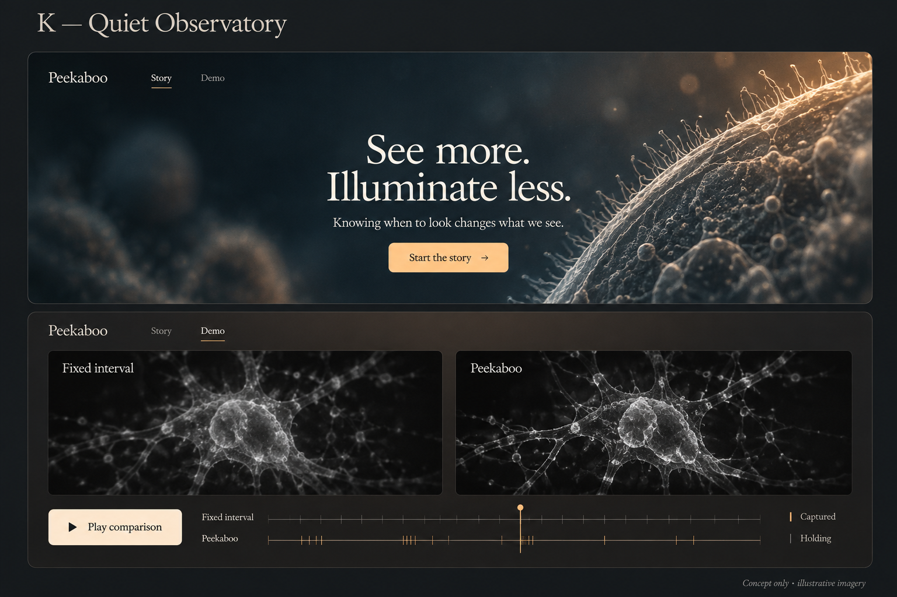

## L — Soft Focus

Muted apricot and rose, plum typography, and a translucent microscope-slide motif.

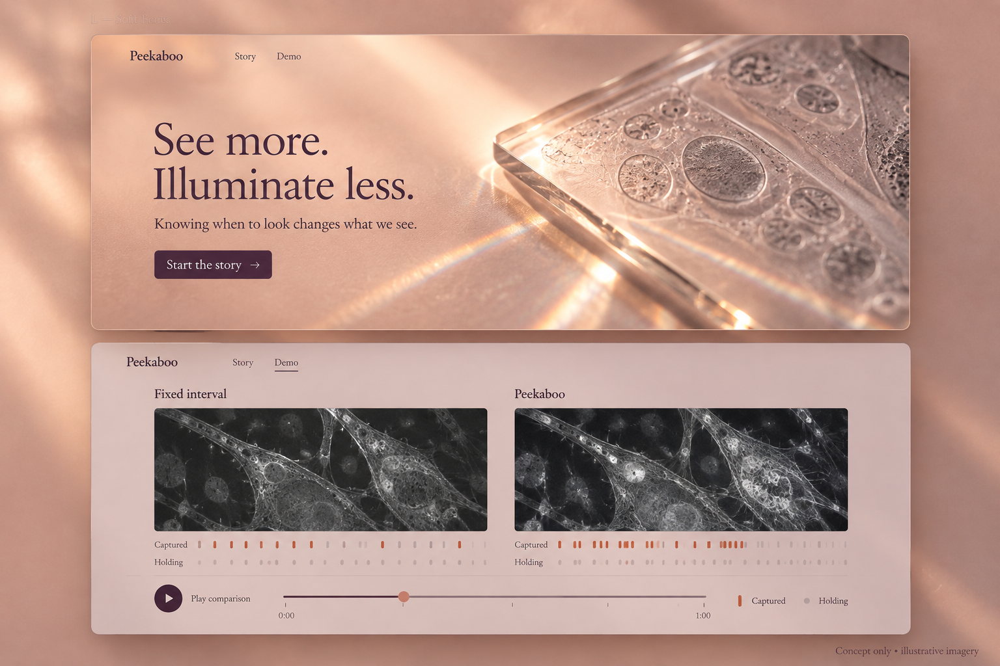

All microscopy, scale bars, exposure patterns, and time labels in these generated boards are illustrative. Actual acquired imagery, model outputs, and verified timings must replace them in any implementation. Atmospheric hero art is conceptual and should not be mistaken for dataset evidence.
