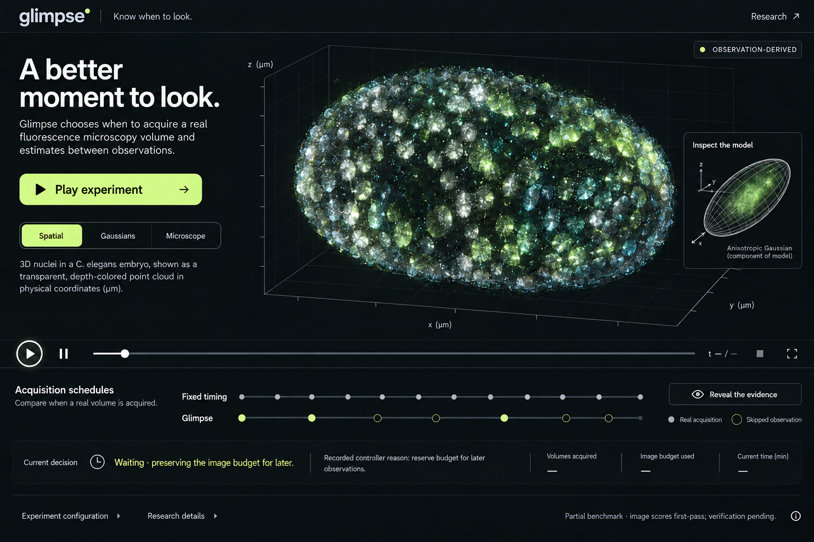
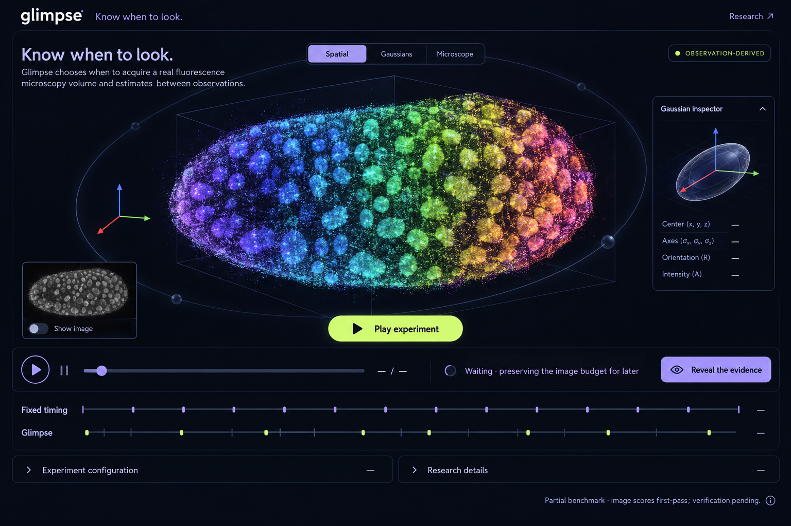
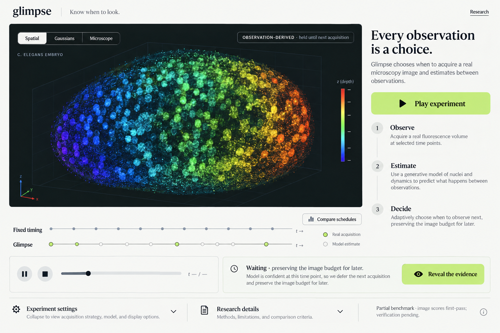

# Glimpse design options

The first three visual directions are retained below as design history. The user liked their viewer ideas but rejected the themes as generic/AI-looking. None is an approved implementation target.

Start with [round 2 — D / E / F](round-2/README.md) for the current mockups. The user selected **E / Contact**, now implemented in `apps/web/`. The [implementation contract](implementation.md) records the design and data rules.

The [website research and revised identity brief](references/README.md) includes captured reference sites and the reasoning behind this reset.

These AI-generated mockups illustrate layout and visual style. Their specimen imagery, timelines and explanatory copy are illustrative, not experimental evidence. Implementation will use authentic acquired volumes, saved causal Gaussian geometry and recorded controller explanations. Any suggested confidence claims or generative-model wording in the mockups must be replaced with scientifically accurate copy. Phase 5 remains paused.

## A — Lens

Graphite and lime, with a clear introductory explanation beside the specimen viewer. Recommended for judge-facing clarity.

[Open full-size image](a-lens.png)

## B — Orbit

Cinematic midnight and violet, with an immersive specimen viewer and Gaussian inspector.

[Open full-size image](b-orbit.png)

## C — Fieldnotes

Bright editorial styling with an explicit Observe → Estimate → Decide explanation.

[Open full-size image](c-fieldnotes.png)

## Shared intended behavior

- Spatial view derived from acquired microscopy voxels.
- Gaussian view using saved model centers, covariances and amplitudes; geometry and rendered estimate remain distinct.
- Microscope view or image toggle for inspecting the original image projection.
- Explicit measured, held-observation, model-estimate and evaluation-only labels.
- Playback, aligned acquisition timelines, recorded decision rationale and explicit evidence reveal.
- Actual scores with partial/pending labels, and accessible experiment settings and provenance.

The existing scientific method is a simplified additive dynamic Gaussian model, not a full CellSplat4D reproduction. Display branding can become Glimpse while frozen scientific artifact identifiers remain unchanged.
