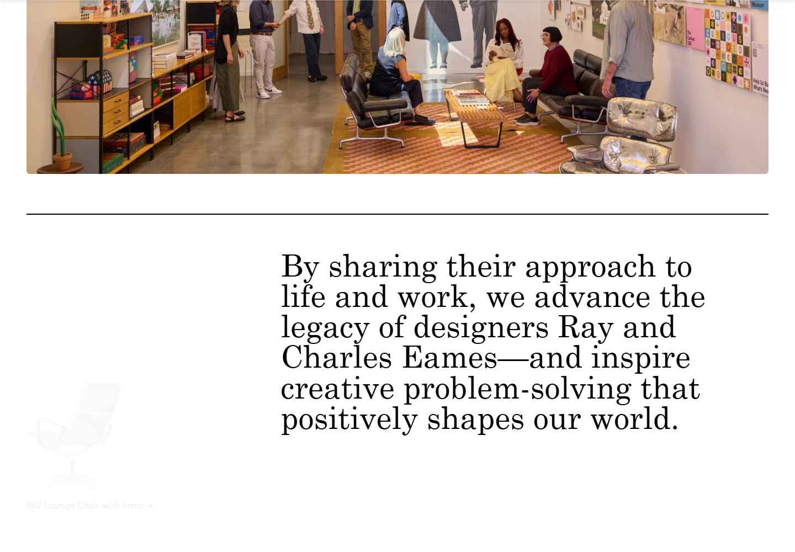
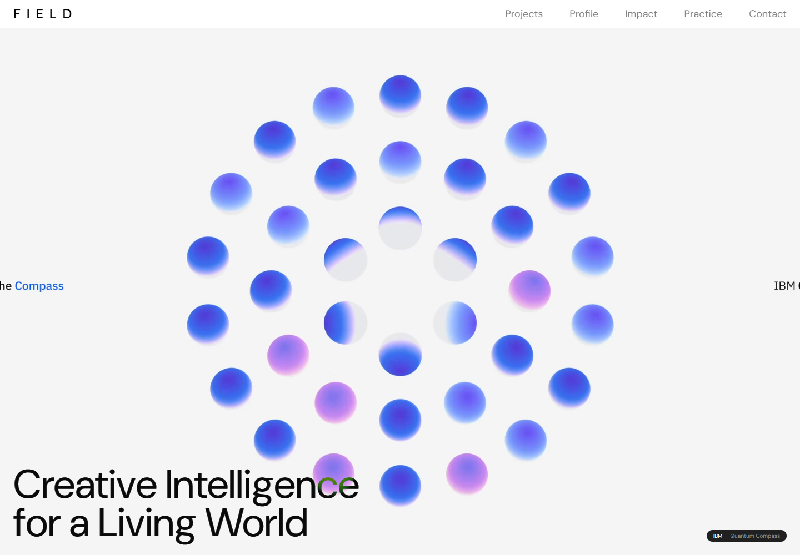
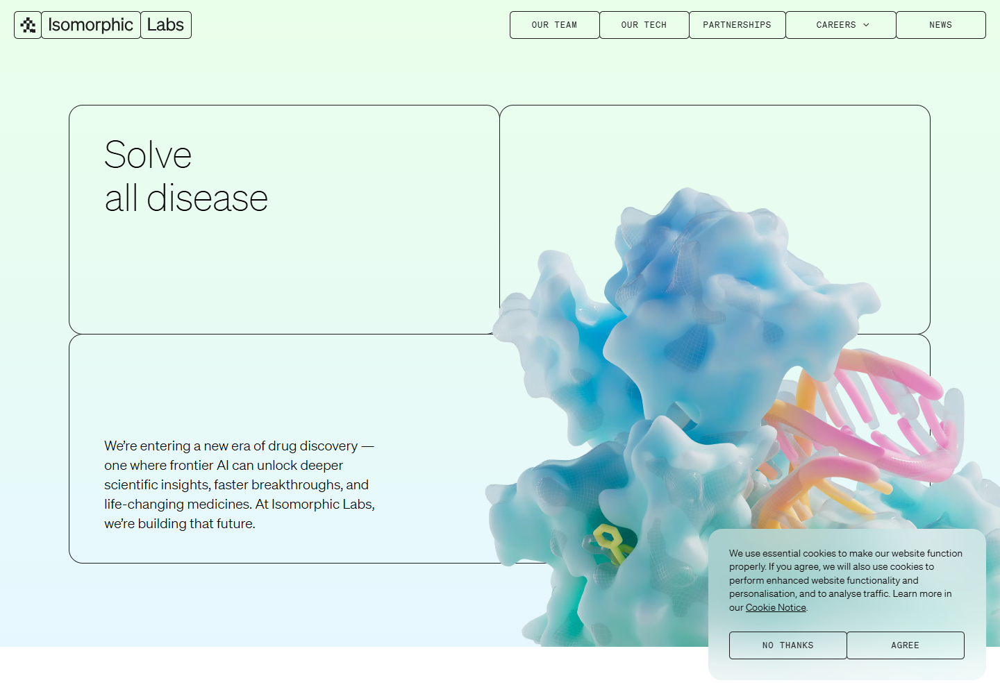
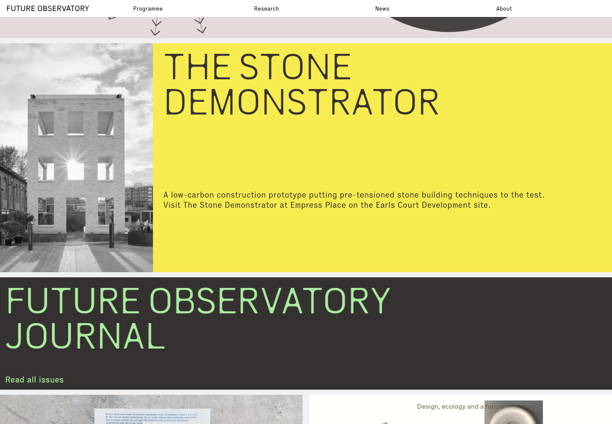

# Glimpse: reference research and identity reset

Reviewed 2026-10-24. The user likes the spatial/Gaussian/microscope viewer idea but wants a more sophisticated, creative and distinctive identity than the first three mockups. Those themes are rejected; the existing working app is unchanged.

These are captures of third-party sites, inspected in Chromium at 1440 × 1000. They are references for discussion, not assets to reuse in the product. Their imagery, marks and design remain attributable to their owners. Motion and lazy loading can make the captures differ from a live visit.

## Useful references

### Eames Institute — typography and editorial confidence

[Visit the site](https://www.eamesinstitute.org/) · [Homepage capture](eames-desktop.png) · [Editorial detail](eames-detail.png)

The inspected pages combine bold sans headings, larger serif editorial statements, substantial whitespace, photography and a restrained accent. Personality comes from hierarchy and content. Borrow the typographic discipline and image treatment; establish our own proportions and wordmark.

### FIELD.IO — a visual system grounded in a subject

[Visit the site](https://field.io/) · [Quantum Compass case study](https://field.io/work/ibm-quantum-compass) · [Homepage capture](field-desktop.png)

The homepage gives its central motion work most of the screen and uses restrained navigation. The Quantum Compass case study connects its visual language to qubit states and uses interactive explanations to make technical material accessible. The relevant lesson is to derive Glimpse's visual grammar from observation, gaps and Gaussian structure. Its particular colors and spheres are not our design brief.

### Isomorphic Labs / Pentagram — one idea across identity and interaction

[Live site](https://www.isomorphiclabs.com/) · [Pentagram case study](https://www.pentagram.com/work/isomorphic-labs) · [Site capture](isomorphic-desktop.png) · [Case-study capture](pentagram-isomorphic-desktop.png)

Pentagram describes an identity organized around digital/biological symmetry, reconfiguring cubic forms and an informational grid. The lesson is coherence: typography, structure and motion should share a reason to exist. For Glimpse, that reason is selective observation. We should develop our own graphic system, not reproduce their cubes or gradients. The case-study text was inspected in the browser; the web text fetch timed out and some embedded media requires optional cookies.

### Future Observatory — a confident research publication

[Visit the site](https://futureobservatory.org/) · [Programme/editorial capture](future-observatory-desktop.png)

Large distinctive lettering, flat color fields, concise navigation and photographic evidence create an identifiable research publication. Borrow the willingness to make a small number of strong graphic decisions; keep our experiment controls easier to find than an exhibition site's navigation.

### Arc Institute — readable scientific context

[Visit the site](https://arcinstitute.org/) · [Capture](arc-desktop.png)

Useful for calm scientific presentation, readable source material and a restrained palette. This is a supporting reference for clarity rather than the main creative direction.

## Revised direction: a contemporary specimen atlas

This is a proposed brief, not a selected design or implemented feature.

Glimpse should feel like a carefully designed place to observe living structure. Its identity should emerge from the relationship between what was acquired, what was estimated and what remains unseen.

- **Composition:** one dominant viewer, a concise explanation, aligned acquisition strips and contextual captions. Experiment settings and scientific evidence remain accessible through clear disclosures. Use an open grid and fewer bordered containers.
- **Palette:** explore a quiet chalk/paper surface, dark ink and one restrained vermilion accent. Keep a dark photographic area where it benefits microscopy. No palette is approved yet; changing the accent alone will not solve the previous round's problems.
- **Typography:** establish a recognizable wordmark and deliberate reading hierarchy. Limit monospace to actual instruments, coordinates and timestamps. A large serif headline by itself is not an identity.
- **Signature element:** a photographic contact strip made from already acquired frames. Gaps remain explicit; forecasts have a separate graphic treatment. Future measurements never appear as advance thumbnails. Fixed and Glimpse strips share the same source clock and budget.
- **Viewer:** retain Spatial / Gaussians / Microscope. Use actual acquired voxels and saved model geometry. Any depth color must encode documented physical depth. Component ellipsoids and the rendered Gaussian estimate are distinct representations.
- **Motion:** acquisition adds a real recorded exposure to the strip; camera movement helps inspect depth; source/model changes have explicit labels. Avoid decorative orbital planets, fake confidence animations and arbitrary particle effects.
- **Copy:** explain the action in ordinary language using the actual recorded reason. Preserve measured/held/forecast/evaluation-only states and partial/pending scores. Do not imply proven biological benefit or calibrated confidence.

The next concept round should test a coherent identity built from these principles, while preserving the viewer interaction ideas the user liked. Do not implement A, B or C as previously rendered.

## Inspection limits

OXMAN was also inspected ([live site](https://www.oxman.com/), [typographic section](oxman-detail.png)). Its videos reported loaded media, but the homepage video did not appear in the captured viewport, so it is not used as a primary imagery reference. Some other captures contain animation transitions. No third-party site behavior is a requirement for Glimpse.
