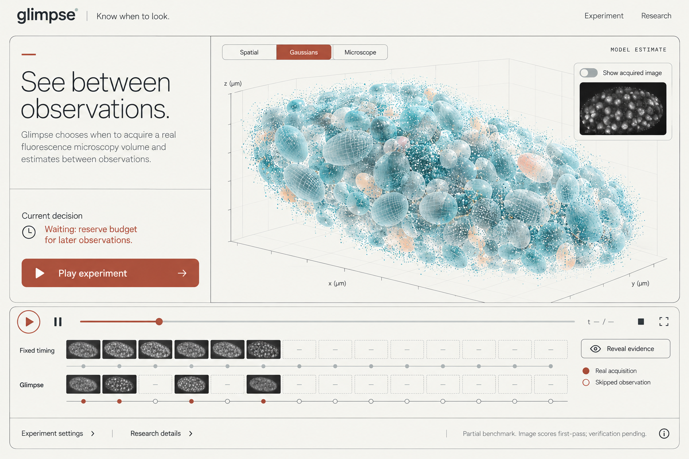
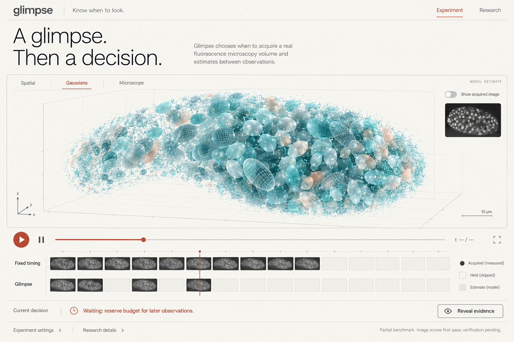
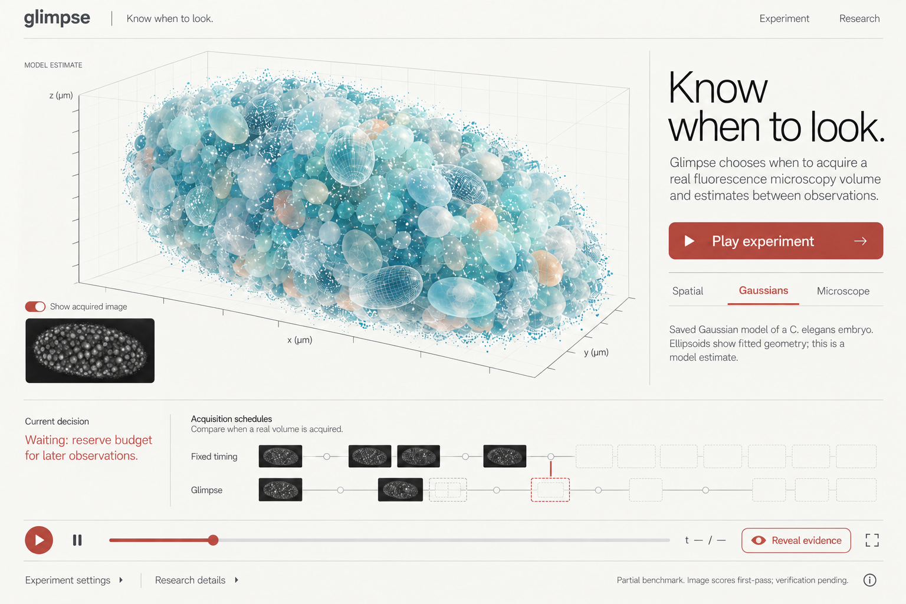

# Glimpse — round 2

Three related compositions following the user's approval of the research direction and particular preference for Isomorphic Labs' visual presentation. **E / Contact was selected and implemented.** See the [implementation contract](../implementation.md) and the running app in `apps/web/`.

This round retains Spatial / Gaussians / Microscope and adopts a light, outlined composition, restrained sans typography, mineral-blue specimen imagery, oxide-red actions and photographic acquisition strips. It draws on the [reference research](../references/README.md) without copying third-party branding or molecular assets.

These are AI-generated visual mockups, not experimental evidence. Specimen imagery and acquisition thumbnails are illustrative. The implementation must use actual acquired data, saved causal Gaussian geometry and recorded decisions. Real data will determine shape, density, component count and timing, even where it differs from these illustrations. Model ellipsoids describe fitted Gaussian geometry, not validated cell boundaries. Source-derived points and model geometry must remain distinct selectable views/layers.

## D — Window

A large outlined study board: introduction and current decision on the left, specimen viewer on the right, and acquisition strips below. The most direct introduction for a new viewer.

[Open full-size](d-window.png)

## E — Contact

A panoramic specimen viewer with a short editorial introduction and an aligned photographic acquisition strip. Recommended for further development: the specimen and observation history have the strongest visual hierarchy with less surrounding interface.

[Open full-size](e-contact.png)

## F — Study

A specimen-plate composition with a narrow explanatory margin, large model geometry and a source-image reference. Includes the same transport and explicit evidence reveal.

[Open full-size](f-study.png)

## Required content and interaction rules

- The source image toggle's state must match thumbnail visibility.
- The current decision sentence is filled from the actual trace, rather than permanently showing the mockup's example.
- Acquisition strips share an exact source-time axis and equal budget. Visible source thumbnails must come from that policy's own acquisitions at or before the current replay time. Future measurements stay hidden until the explicit evaluation reveal.
- Source voxels, Gaussian component geometry and rendered density have separate labels. A fitted scene at an acquisition is labeled model fit; a propagated scene is labeled forecast. Neither becomes a measured image through a styling change.
- Any scale bar is calculated from physical spacing and the current camera projection, not copied from a mockup.
- Controls retain keyboard operation, visible focus, adequate target size and readable contrast; the faint microcopy in the mockups is not a license to reduce accessibility.
- Existing metric provenance, partial/pending labels, matched-target caveats and research disclosures remain available. These primary-screen mockups show that content collapsed, not removed.
- Phase 5 remains paused. The viewer now implements E; the frozen scientific implementation remains unchanged.
